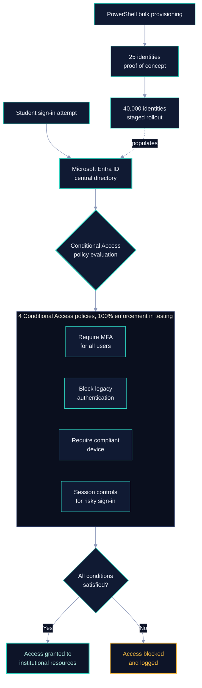

# Zero Trust Architecture - Phase 1

## Designing and Validating a Centralized Identity and Access Management Solution for 40,000 Student Identities

### Overview

This project addresses critical cybersecurity vulnerabilities at a large academic institution (40,000+ students) by designing, configuring, and testing a centralized Identity and Access Management (IAM) solution using **Microsoft Entra ID**.

### The Problem

The institution lacks basic cybersecurity controls:
- No centralized directory service
- Sequential student IDs used as both usernames and passwords
- No Multi-Factor Authentication (MFA)
- No institutional email infrastructure

### Solution

A proof-of-concept IAM deployment featuring:
- **25 simulated student identities** in Microsoft Entra ID
- **4 Conditional Access policies** enforcing MFA
- **IAM governance framework** aligned with NIST CSF 2.0 and ISO/IEC 27001:2022
- **PowerShell bulk provisioning** template for scaling to 40,000 users

### Architecture

### Frameworks & Standards

- NIST SP 800-207 (Zero Trust Architecture)
- NIST SP 800-30 Rev. 1 (Risk Assessment)
- NIST Cybersecurity Framework 2.0
- ISO/IEC 27001:2022
- Forrester Zero Trust Model

### Methodology

Design Science Research (DSR) methodology conducted within a controlled Microsoft Azure environment.

### Results

- 100% policy enforcement across all four Conditional Access scenarios
- Zero failures during testing
- Staged rollout strategy validated for scaling from 25 to 40,000 identities

### Phase 1 Scope

This Phase 1 implementation establishes the foundation for a broader Zero Trust transformation, including future:
- Network segmentation
- Endpoint management
- Advanced threat protection

### Documentation

- [Zero_Trust_IAM_Phase1_Proposal.docx](Zero_Trust_IAM_Phase1_Proposal.docx) - Full project documentation

### Tech Stack

- Microsoft Entra ID (Azure AD)
- Microsoft Azure
- PowerShell
- Conditional Access Policies
- Multi-Factor Authentication (MFA)
